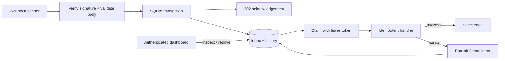
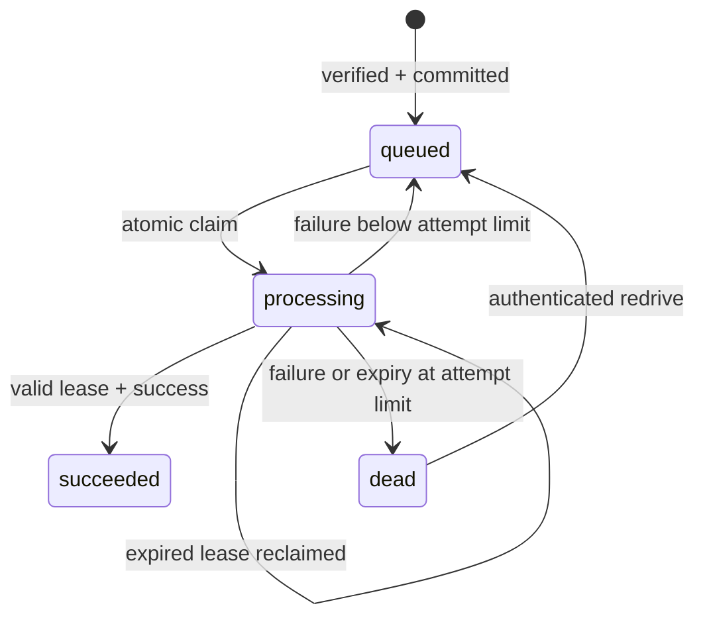

# HookLedger

[](https://github.com/thinandyavin-tech/hookledger/actions/workflows/ci.yml)


[](LICENSE)

**A durable webhook inbox that makes retries, crashes, and duplicate deliveries visible.**

Webhook senders retry. Workers crash. A downstream service sometimes responds after your timeout. HookLedger explores how to keep an honest record of that work: verify the request, commit it to SQLite, and process it with bounded retries and fenced worker leases.

Built with TypeScript, Node.js 24, and SQLite. No runtime npm dependencies. Includes a responsive operations dashboard and a reproducible failure demo.

## Run locally

Requires **Node.js 24.12+ (24.x)**. TypeScript runs using Node's native type stripping; `npm run check` checks types separately.

```sh
git clone https://github.com/thinandyavin-tech/hookledger.git
cd hookledger
npm ci
npm run setup
npm start
```

Open **http://127.0.0.1:4310**. Copy `ADMIN_TOKEN` from the generated `.env` into the dashboard. The token stays in browser memory and is cleared when the page reloads.

In another terminal:

```sh
npm run demo
```

The demo sends five signed events, repeats one, reuses an ID with changed data, and sends an invalid signature. Expected HTTP responses: `202` × 5, `200` duplicate, `409` conflict, `401` invalid signature. After approximately five seconds, four events have succeeded and one is in the dead-letter state. Click an event to inspect its history. **Retry** starts a new attempt cycle; the intentionally poisonous demo event will fail again.

The shipped handler simulates successful, transiently failing, and permanently failing work. It does **not** charge payments, call LINE, or deliver outbound webhooks. Replace `demoHandler` in [src/worker.ts](src/worker.ts) with a bounded, idempotent business operation to integrate a real service.

## What this demonstrates

| Concern | Implementation | Evidence |
| --- | --- | --- |
| Duplicate delivery | Unique event ID and SHA-256 of exact body bytes | Duplicate and conflicting-payload tests |
| Spoofed / replayed requests | HMAC-SHA256 binds ID, timestamp and raw body; ±5-minute window | Tampering, expired/future timestamp and ID-substitution tests |
| Durable acceptance | SQLite transaction writes event and history before `202` | Reopen and transaction rollback tests |
| Concurrent claims | `BEGIN IMMEDIATE` serializes writers | Two-connection lease test |
| Worker crashes | Expired leases are reclaimable; claims consume attempts | Reclaim and final-attempt crash tests |
| Stale workers | Unique lease tokens fence completion writes | Old token cannot overwrite a newer attempt |
| Downstream failure | Exponential backoff, three attempts, dead-letter state | Retry timing and attempt-limit tests |
| Operator recovery | Authenticated redrive with retained audit history | Redrive and access-control tests |

## Architecture





The worker makes no network call while a database transaction is open. A claim increments the attempt counter and issues a fresh token. Completion must present that token before its lease expires. An old process can finish late, but cannot overwrite the new owner's database state.

See [design decisions and failure boundaries](docs/design.md) for the limits of this guarantee.

## API

### Accept an event

`POST /v1/events`, `Content-Type: application/json`

```json
{"type":"order.created","data":{"orderId":"ORD-1024","amount":250,"currency":"THB"}}
```

Required headers:

| Header | Value |
| --- | --- |
| `X-Webhook-Id` | Unique ID, 1–128 characters: letters, numbers, `_`, `-` |
| `X-Webhook-Timestamp` | Unix time in seconds |
| `X-Webhook-Signature` | Lowercase hex HMAC-SHA256 of `id.timestamp.rawBody` |

The signature covers the **exact UTF-8 body string**. JSON whitespace changes the signature and payload hash. Generate signatures with [the example sender](scripts/demo.ts) or [the signing helper](src/auth.ts). This is HookLedger's own protocol, not a drop-in implementation of Stripe, LINE, or GitHub webhook signatures.

Responses: `202` committed, `200` identical duplicate, `409` ID reused with different bytes, `401` invalid/expired signature, `400` invalid schema, `413` over 64 KiB, `415` wrong content type.

### Operations

All `/api/*` routes require `Authorization: Bearer <ADMIN_TOKEN>`.

| Method | Path | Purpose |
| --- | --- | --- |
| GET | `/api/jobs` | Latest 100 events and all-time state counts; excludes payloads and lease tokens |
| GET | `/api/jobs/:id/history` | Latest 100 audit entries for an event |
| POST | `/api/jobs/:id/retry` | Redrive a dead event; active/completed events return `409` |
| GET | `/health` | Public process liveness |

## Verify

```sh
npm run check
npm test
```

Tests use actual SQLite databases and HTTP servers, including a file-backed restart test. CI runs on Ubuntu and Windows. No service credentials are needed.

## Container

```sh
docker build -t hookledger .
docker volume create hookledger-data
docker run --rm --env-file .env -p 127.0.0.1:4310:4310 \
  -e HOST=0.0.0.0 -v hookledger-data:/app/data hookledger
```

The example above uses POSIX line continuation; use one line in PowerShell. The container runs as the non-root `node` user. The named volume preserves the inbox across container restarts. Docker is an optional packaging path; local Node is the primary quickstart.

## Scope and limitations

- **At-least-once**, not exactly-once. A crash after an external side effect and before completion may repeat that side effect. Downstream operations must use the event ID as an idempotency key.
- **Single node, modest traffic.** Synchronous SQLite simplifies transaction reasoning but blocks Node's event loop during database operations. No throughput benchmark or high-availability claim.
- Leases last 30 seconds. There is no heartbeat. A slow/hung handler can outlive a lease; bound your handler's runtime. Lease fencing protects database transitions, not remote side effects.
- All events share one signing secret and one admin token. There is no tenant isolation, user management, key rotation workflow, rate limiting, or automated retention policy.
- Bodies, error messages and history are persisted locally. Do not send real customer data to the demo. A real deployment needs TLS, access controls, backups, retention, and redaction appropriate to its data.
- Backoff is deterministic (1s then 2s under the three-attempt default). There is no jitter; synchronized retry bursts are a known limitation.
- The SQLite API is built into Node 24 and its stability status depends on the selected Node patch release. Pin and test the runtime you deploy.

## Contributing

See [CONTRIBUTING.md](CONTRIBUTING.md). Focused bug reports, failure reproductions, and tested fixes are welcome. This is an engineering portfolio project built with AI-assisted development; behavior claims should be judged against the code and executable tests.

MIT © Yavin Songkham
